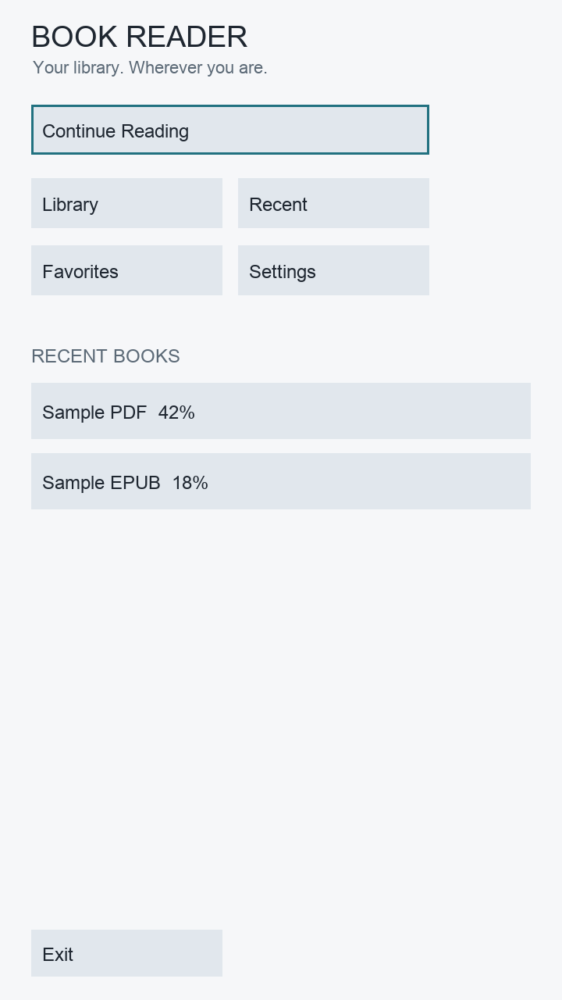
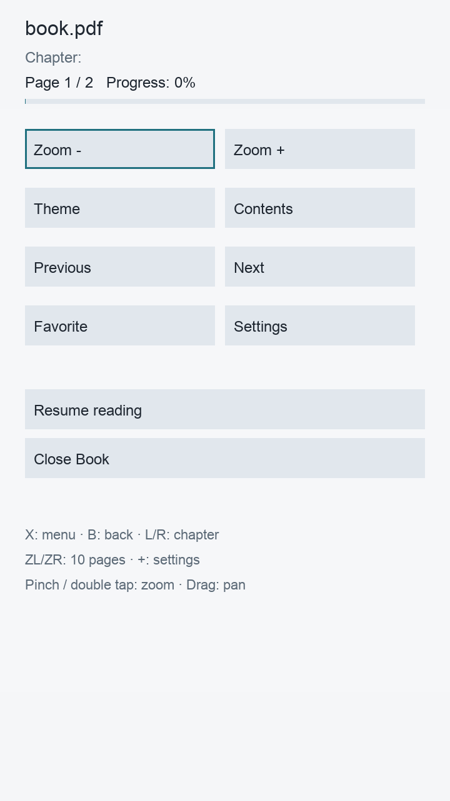
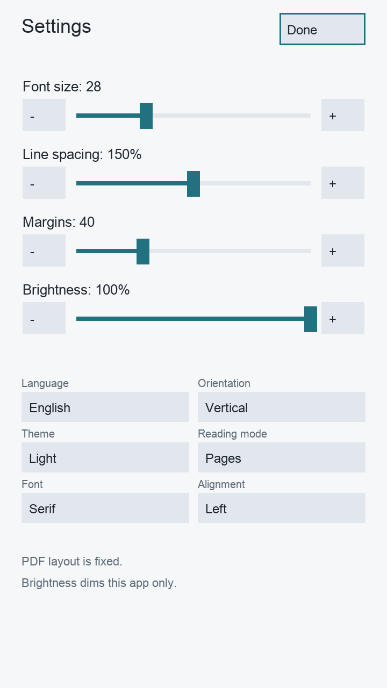

# BookReader for Nintendo Switch

[English](README.md) · [Русский](README_RU.md)

BookReader is an offline ebook and comic reader for Nintendo Switch homebrew.
It reads books directly from the microSD card, supports Joy-Con and touch input,
and provides both landscape and portrait reading layouts.

Version **0.2.0** is written in C++17 with libnx, SDL2, FreeType, and the official
devkitPro MuPDF port. It does not use Nintendo SDK APIs or require a network connection.

> [!IMPORTANT]
> The NRO is cross-compiled and structurally validated, and the shared application
> code passes the host test suite. The maintainer also launched this build on a
> physical Nintendo Switch OLED and opened books successfully.

## Screenshots

| Home | Reader menu | Settings |
| --- | --- | --- |
|  |  |  |

## Features

- Offline library stored under `/switch/BookReader/books/`
- Recursive folder scanning, up to 32 directory levels and 10,000 books
- Search by title and sorting by title, author, file date, format, or last opened time
- Recent list with up to 20 books and a persistent favorites list
- Per-book reading progress, last page, chapter, text offset, zoom, pan, and display settings
- Debounced autosave with a backup configuration file
- English and Russian interface, switchable immediately and saved across restarts
- Landscape 1280×720 and portrait 720×1280 interface modes
- Touch controls with tap, swipe, drag, long press, double tap, and two-finger pinch
- Light, Sepia, and Dark themes
- Page and continuous scroll modes for reflowable books
- Adjustable font size, line spacing, margins, alignment, app dimming, and font family
- EPUB cover extraction and first-page thumbnails for other formats
- Bounded memory and disk caches designed for Switch homebrew constraints
- **Wi-Fi upload** from a phone or PC browser (press `−` in the home screen)

## Web upload

Press **`−`** on the home screen to start a small HTTP server on port **8080**.
Open the address shown on screen from a phone or PC connected to the **same
Wi-Fi network**:

```
http://<Switch IP>:8080
```

The upload form accepts the formats BookReader can open: **PDF, EPUB, TXT, FB2,
HTML/HTM, CBZ and MD**. Files are streamed to disk (never loaded fully into RAM),
checked by extension and file signature, and saved to
`/switch/BookReader/books/`. The library rescans automatically after each upload.
Press **`−`** again to stop the server.

The server has no password and is meant for a trusted local network. Stop it
when you are done.

## Supported formats

| Format | Support | Implementation and limitations |
| --- | --- | --- |
| **PDF** | Full core support | Rendered with MuPDF. Page navigation, page count, 1–4× zoom, pan, fit-to-screen, progress, and portrait presentation are supported. Password-protected and DRM files are not supported. Raster output is capped at 2048 px per side and 4 million pixels. |
| **EPUB 2/3** | Supported | MuPDF handles ZIP/OPF/XHTML/CSS and images. The application adds EPUB 3 navigation parsing, metadata, chapter lists, and cover extraction. JavaScript, audio/video, DRM, and full browser-grade CSS are not supported. Fixed-layout EPUB is not guaranteed. |
| **TXT** | Supported | Streaming reader with UTF-8 and BOM-marked UTF-16 LE/BE, automatic wrapping, lazy page access, and persistent byte offsets. Files are limited to 512 MiB. CP1251 and other legacy encodings are not detected. |
| **FB2** | Supported subset | XML is converted to reflowable HTML. Title, author, sections, headings, emphasis, strong text, and embedded PNG/JPEG images are supported. FB2.ZIP, footnote navigation, and arbitrary binary formats are not supported. |
| **HTML / HTM** | Supported subset | Rendered by MuPDF with common text structure, lists, images, and basic CSS. There is no JavaScript, network access, forms, or full web browser engine. |
| **CBZ** | Supported | ZIP-based image comics are displayed page by page with zoom and pan. CBR/RAR is not supported. |
| **Markdown / MD** | Plain text only | The file is opened through the TXT reader. Markdown syntax is shown as text and is not formatted. |

The format factory accepts only `.pdf`, `.epub`, `.txt`, `.fb2`, `.html`,
`.htm`, `.cbz`, and `.md`. MOBI, AZW, AZW3, RTF, CBR, and DOCX are not
implemented and produce an “Unsupported format” message.

Additional input limits protect memory:

- EPUB file size: 128 MiB
- FB2 and HTML input size: 24 MiB
- FB2 embedded image: 8 MiB each, 12 MiB total decoded image budget
- Table of contents: up to 4,096 entries
- Page raster: up to 2048×2048 and 4 million pixels

## PDF reading

PDF documents use the official `switch-mupdf` port. The application keeps a small
LRU cache around the current page instead of loading the complete document into RAM.
The reader supports page changes, fast ±10-page jumps, zoom, drag/stick panning,
double-tap zoom, pinch zoom, page progress, and restoration of page/zoom/pan state.

Portrait mode changes the presentation viewport while leaving the PDF parser and
rendering backend unchanged. The PDF page itself is never reflowed.

## EPUB and reflowable books

EPUB, HTML, and converted FB2 content is laid out for the active logical viewport.
Changing font size, margins, line spacing, theme, alignment, or orientation triggers
reflow. The application restores the nearest position using the existing page
percentage mechanism; the exact word may shift when pagination changes.

EPUB 2 NCX and EPUB 3 navigation documents are exposed through the Contents screen.
Metadata and covers become available after the book has been opened.

## Languages and fonts

The interface can be switched between **English** and **Русский** in Settings.
The selected language is stored as `language=en` or `language=ru`.

UI and TXT rendering use FreeType. On Switch, BookReader loads libnx shared fonts
and combines them with optional TTF, OTF, or TTC files from:

```text
/switch/BookReader/fonts/
```

At startup, the application checks Cyrillic coverage from А to Я, а to я, including
Ё and ё. If no suitable font is available, it shows an error instead of silently
rendering squares. User-supplied fonts are not included in the release.

MuPDF uses embedded document fonts and its own fallback fonts for PDF/EPUB/HTML/FB2.

## Landscape and portrait

Settings offers:

- **Horizontal / Landscape:** logical area 1280×720
- **Vertical / Portrait:** logical area 720×1280

Portrait mode rotates the complete application clockwise. Hold the console with the
right Joy-Con at the top. The renderer and touch input share one
`OrientationTransform`, so buttons, sliders, lists, search, reading gestures, and
PDF panning use matching coordinates. Orientation is applied immediately and stored
as `orientation=landscape` or `orientation=portrait`.

There is no sensor-based automatic rotation.

## Touch controls

- Tap a book or button to activate it
- Long-press a library row to open its context menu
- Tap the center of the reader to show or hide the reader menu
- Tap the left or right edge to change page
- Swipe horizontally to change page
- Drag vertically to scroll reflowable content
- Drag a zoomed PDF or CBZ page to pan
- Pinch with two fingers to zoom PDF/CBZ from fit-to-screen up to 4×
- Double-tap PDF/CBZ to toggle fit-to-screen and 2× zoom
- Drag settings sliders directly

Gesture thresholds prevent a normal tap from becoming a swipe, and a completed pinch
consumes the remaining contact sequence to avoid an accidental tap.

## Joy-Con controls

| Control | Action |
| --- | --- |
| A | Select; open the reader menu when hidden |
| B | Back; close the book when the reader menu is hidden |
| X | Show or hide the reader menu |
| Y | Toggle favorite |
| D-Pad Left / Right | Previous / next page |
| D-Pad Up / Down | Scroll or pan; navigate UI focus |
| L / R | Previous / next chapter |
| ZL / ZR | Jump backward / forward 10 pages |
| Left or Right Stick | Scroll or pan a zoomed page |
| − | Home: start / stop the web upload server; other screens: open Settings |
| + | Open or close Settings |

Directions are transformed in portrait mode so navigation remains aligned with the
rotated interface. The Capture and Home buttons remain system-managed.

## Themes and reading settings

- Light, Sepia, and near-black Dark themes
- Font size from 16 to 56 px
- Line spacing from 1.0 to 2.0
- Margins from 16 to 100 px
- Left, center, or right alignment
- Serif, sans-serif, or monospace family for reflowable MuPDF documents
- User/system font selection for TXT and plain Markdown
- Page or continuous scroll reading mode
- Application-only dimming from 25% to 100%

PDF page colors are not inverted by Dark theme.

## Library, progress, and cache

The library scans:

```text
/switch/BookReader/books/
```

Subfolders are supported; hidden entries and symbolic links are skipped. State is
stored in:

```text
/switch/BookReader/config/state.ini
```

The configuration uses a temporary file, flush/fsync, atomic rename, and a `.bak`
fallback. Changes are debounced to reduce microSD writes, with reading checkpoints
approximately every 15 seconds and saves on page changes, book close, focus loss,
and application exit.

Caches are stored under `/switch/BookReader/cache/`:

- cover thumbnails: 32 MiB
- TXT pagination indexes: 32 MiB
- generated FB2 HTML/resources: 64 MiB
- up to three page rasters around the current page
- up to 24 cover textures in the UI

Cache directories can be removed while the application is closed.

## Installation

Download or build the release package and extract it to the root of the microSD card:

```text
switch/
└── BookReader/
    ├── BookReader.nro
    ├── books/
    ├── fonts/
    ├── cache/
    │   └── covers/
    └── config/
```

Place books in `/switch/BookReader/books/` and launch BookReader from Homebrew Menu.
For large PDF and EPUB files, use a full-memory Homebrew Menu session rather than
restricted applet mode.

The repository contains:

- `BookReader_v2.nro` — version 0.2.0 binary
- `BookReader_v2.zip` — ready-to-extract SD package
- `BookReader_backup.nro` — preserved version 0.1.0 binary

## Build requirements

- devkitPro
- devkitA64
- libnx and Switch tools
- `switch-sdl2`
- `switch-freetype`
- `switch-mupdf`
- `switch-pkg-config`
- Switch JPEG, PNG, zlib, and bzip2 portlibs

Install the macOS devkitPro pacman package, then:

```sh
sudo dkp-pacman -Syu
sudo dkp-pacman -S --needed switch-dev
sudo dkp-pacman -S --needed switch-sdl2 switch-freetype switch-mupdf \
  switch-libjpeg-turbo switch-libpng switch-zlib switch-bzip2 switch-pkg-config

export DEVKITPRO=/opt/devkitpro
export DEVKITA64="$DEVKITPRO/devkitA64"
export PATH="$DEVKITPRO/tools/bin:$DEVKITA64/bin:$PATH"

make clean
make
```

The result is `BookReader.nro` with NACP metadata:

```text
Title:   BookReader
Author:  Homebrew
Version: 0.2.0
```

An alternative official-container workflow is available:

```sh
CONTAINER_ENGINE=docker sh tools/build_container.sh
python3 tools/verify_nro.py
make package
```

## Tests and build status

Version 0.2.0 was cross-compiled with:

- devkitA64 r29.2-1
- libnx 4.12.0-1
- switch-mupdf 1.17.0-1
- switch-sdl2 2.28.5-4
- switch-freetype 2.13.3-1

Validation performed:

- 117 integration checks for real PDF, EPUB 2/3, TXT, HTML, FB2, and CBZ fixtures
- 612 UI checks for localization, Cyrillic glyphs, adaptive layout, transformed touch,
  pinch/pan, PDF paging, EPUB reflow, and settings persistence
- SDL event-loop regression test
- ASan/UBSan run for application code
- NRO0 segments, ASET, JPEG icon, NACP, version, and ARM64 ELF validation

See [BUILD_V2.md](BUILD_V2.md) for exact output, hashes, known warnings, and test logs.

## Project structure

```text
source/
├── app/       application lifecycle, input, worker coordination
├── config/    persistent INI state
├── readers/   format factory and PDF/EPUB/TXT/FB2/HTML/CBZ adapters
├── render/    FreeType text rendering
├── storage/   recursive library scanning and sorting
├── ui/        screens, controls, gestures, localization, orientation transform
└── utils/     UTF-8, files, cache helpers, bounded allocator
```

## Known limitations

- No DRM or password-protected PDF/EPUB support
- No MOBI, AZW, AZW3, RTF, CBR, or DOCX support
- Markdown is displayed as plain text
- EPUB/HTML CSS support is intentionally simpler than a browser
- Fixed-layout EPUB is not guaranteed
- Changing reflow settings restores an approximate percentage position
- PDF detail can be reduced by the safe raster cap at high zoom
- Individual MuPDF parse/render calls cannot be cancelled immediately

## License

BookReader source code and icon are licensed under
[AGPL-3.0-or-later](LICENSE). MuPDF is also AGPL-licensed unless used under a
separate commercial license. Third-party notices are listed in
[THIRD_PARTY.md](THIRD_PARTY.md).
