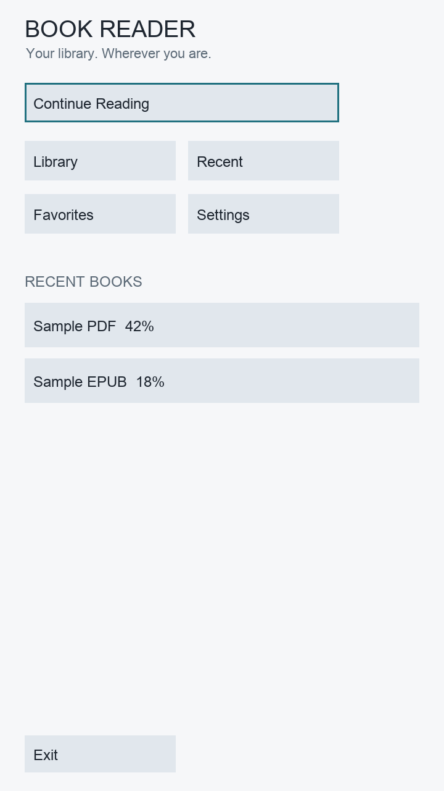
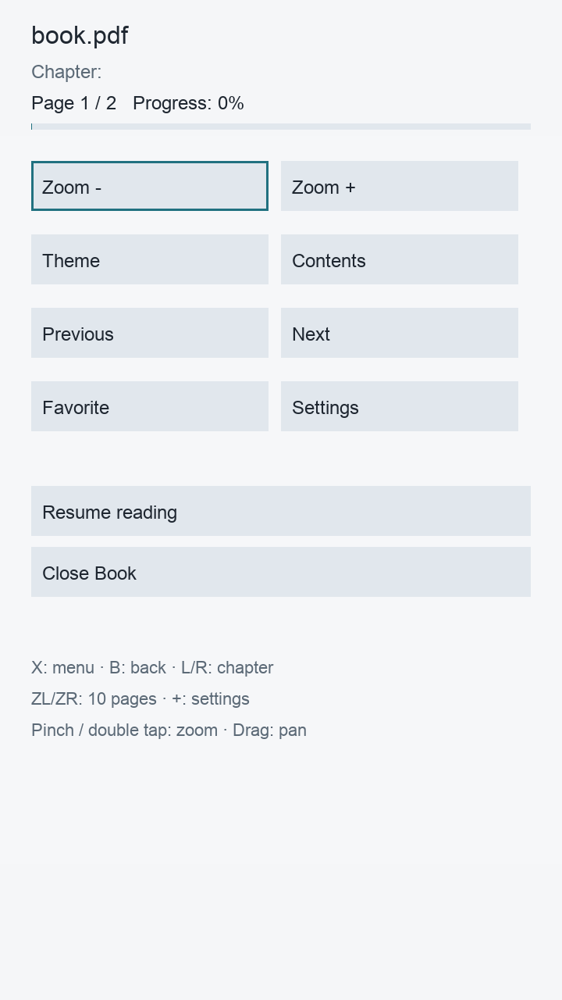
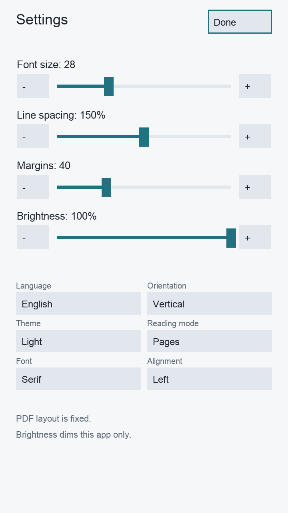

# BookReader для Nintendo Switch

[English](README.md) · [Русский](README_RU.md)

BookReader — автономная читалка книг и комиксов для Nintendo Switch homebrew.
Она читает файлы непосредственно с microSD, управляется Joy-Con и сенсорным
экраном и поддерживает горизонтальный и вертикальный режимы чтения.

Версия **0.2.0** написана на C++17 с использованием libnx, SDL2, FreeType и
официального порта MuPDF от devkitPro. Приложение не использует Nintendo SDK и
не требует подключения к интернету.

> [!IMPORTANT]
> NRO собран настоящим cross-toolchain и прошёл структурную проверку; общий код
> приложения прошёл host-тесты. Автор также запустил эту сборку на физическом
> Nintendo Switch OLED и успешно открыл книги.

## Скриншоты

| Главный экран | Меню чтения | Настройки |
| --- | --- | --- |
|  |  |  |

## Возможности

- Автономная библиотека в `/switch/BookReader/books/`
- Рекурсивное сканирование подпапок: до 32 уровней и 10 000 книг
- Поиск по названию
- Сортировка по названию, автору, дате файла, формату и последнему открытию
- До 20 недавних книг и постоянный список избранного
- Сохранение страницы, главы, текстового смещения, масштаба, панорамирования и настроек
- Автосохранение с задержкой и резервная копия конфигурации
- Интерфейс English / Русский с мгновенным переключением
- Горизонтальный интерфейс 1280×720 и вертикальный 720×1280
- Управление Joy-Con и сенсорные жесты
- Светлая, сепия и тёмная темы
- Постраничный режим и непрерывная прокрутка для текстовых книг
- Размер шрифта, интервал, поля, выравнивание, затемнение и выбор семейства шрифта
- Извлечение обложки EPUB и миниатюры первой страницы остальных форматов
- Ограниченные кэши и контроль памяти для Nintendo Switch

## Поддерживаемые форматы

| Формат | Статус | Реализация и ограничения |
| --- | --- | --- |
| **PDF** | Основные функции полностью поддерживаются | Рендер MuPDF, страницы, общее число страниц, масштаб 1–4×, перемещение, fit-to-screen, прогресс и Portrait. Нет DRM и PDF с паролем. Растр ограничен 2048 px по стороне и 4 миллионами пикселей. |
| **EPUB 2/3** | Поддерживается | MuPDF обрабатывает ZIP/OPF/XHTML/CSS и изображения. Собственный адаптер добавляет EPUB 3 nav, metadata, главы и обложку. Нет DRM, JavaScript, audio/video и полного browser CSS. Fixed-layout EPUB не гарантируется. |
| **TXT** | Поддерживается | Потоковое чтение UTF-8 и UTF-16 LE/BE с BOM, перенос строк, ленивый доступ к страницам и сохранение byte offset. Лимит 512 MiB. CP1251 и другие старые кодировки автоматически не определяются. |
| **FB2** | Поддерживается частично | XML преобразуется в reflowable HTML. Работают название, автор, секции, заголовки, emphasis/strong и встроенные PNG/JPEG. Нет FB2.ZIP, навигации по сноскам и произвольных форматов изображений. |
| **HTML / HTM** | Базовая поддержка | MuPDF отображает обычную структуру текста, списки, изображения и базовый CSS. Нет JavaScript, сети, форм и полноценного браузерного движка. |
| **CBZ** | Поддерживается | ZIP-комиксы отображаются постранично с масштабированием и перемещением. CBR/RAR не поддерживается. |
| **Markdown / MD** | Как обычный текст | Файл открывается через TXT reader. Markdown-разметка не преобразуется в форматированный текст. |

`BookFactory` принимает только расширения `.pdf`, `.epub`, `.txt`, `.fb2`,
`.html`, `.htm`, `.cbz` и `.md`. MOBI, AZW, AZW3, RTF, CBR и DOCX не
реализованы: приложение показывает сообщение «Формат не поддерживается».

Для защиты памяти действуют ограничения:

- EPUB: до 128 MiB
- FB2 и HTML: до 24 MiB исходного файла
- Встроенная картинка FB2: до 8 MiB; общий decoded budget — 12 MiB
- Оглавление: до 4096 пунктов
- Растр страницы: до 2048×2048 и не более 4 миллионов пикселей

## Чтение PDF

PDF использует официальный порт `switch-mupdf`. Приложение держит небольшой LRU
вокруг текущей страницы и не загружает документ целиком в RAM. Доступны листание,
переходы ±10 страниц, масштаб, drag/stick pan, double tap, pinch, прогресс и
восстановление страницы, масштаба и положения.

Portrait меняет область и способ отображения, не затрагивая PDF parser и backend.
Содержимое PDF не перевёрстывается.

## EPUB и перевёрстываемые книги

EPUB, HTML и преобразованный FB2 рассчитываются под текущую логическую область.
Изменение размера шрифта, полей, интервала, темы, выравнивания или ориентации
вызывает reflow. Приложение восстанавливает ближайшее место по существующему
проценту страницы; при изменении пагинации конкретное слово может сместиться.

EPUB 2 NCX и EPUB 3 navigation document отображаются в разделе «Оглавление».
Metadata и обложка появляются после первого открытия книги.

## Языки и шрифты

В Настройках можно выбрать **English** или **Русский**. Выбор сохраняется как
`language=en` или `language=ru`.

Интерфейс и TXT отображаются через FreeType. На Switch приложение объединяет
shared fonts libnx с необязательными TTF, OTF и TTC из:

```text
/switch/BookReader/fonts/
```

При запуске проверяется наличие кириллицы А–Я, а–я, Ё и ё. Если подходящего
шрифта нет, приложение показывает ошибку вместо квадратов. Пользовательские
шрифты не входят в пакет.

Для PDF, EPUB, HTML и FB2 MuPDF использует встроенные в документы шрифты и
собственные fallback-шрифты.

## Горизонтальная и вертикальная ориентация

В Настройках доступны:

- **Горизонтальная / Landscape:** логическая область 1280×720
- **Вертикальная / Portrait:** логическая область 720×1280

В Portrait всё приложение поворачивается по часовой стрелке. Switch нужно держать
правым Joy-Con вверх. Рендер и touch используют единый `OrientationTransform`,
поэтому координаты кнопок, ползунков, списков, поиска, жестов чтения и PDF pan
совпадают. Режим применяется сразу и сохраняется как
`orientation=landscape` или `orientation=portrait`.

Автоповорота по датчику нет.

## Сенсорное управление

- Tap по книге или кнопке — открыть или активировать
- Long press по строке — контекстное меню
- Tap в центре reader — показать или скрыть меню чтения
- Tap по левому или правому краю — предыдущая или следующая страница
- Горизонтальный swipe — перелистывание
- Вертикальный drag — прокрутка reflowable книги
- Drag увеличенного PDF/CBZ — перемещение страницы
- Pinch двумя пальцами — масштаб PDF/CBZ от fit-to-screen до 4×
- Double tap — переключение fit-to-screen / 2×
- Ползунки в Настройках управляются пальцем

Порог движения отделяет tap от swipe. После pinch оставшийся палец не вызывает
случайный tap.

## Управление Joy-Con

| Кнопка | Действие |
| --- | --- |
| A | Выбрать; открыть скрытое меню чтения |
| B | Назад; закрыть книгу, если меню скрыто |
| X | Показать или скрыть меню чтения |
| Y | Добавить в избранное или убрать |
| D-Pad Left / Right | Предыдущая / следующая страница |
| D-Pad Up / Down | Прокрутка или pan; перемещение фокуса |
| L / R | Предыдущая / следующая глава |
| ZL / ZR | Переход назад / вперёд на 10 страниц |
| Left / Right Stick | Прокрутка или pan увеличенной страницы |
| − | Открыть или закрыть Настройки |
| + | Открыть или закрыть Настройки |

В Portrait направления преобразуются относительно повёрнутого интерфейса.
Capture и Home остаются системными кнопками.

## Темы и настройки чтения

- Светлая, Сепия и почти чёрная Тёмная темы
- Размер шрифта 16–56 px
- Межстрочный интервал 1.0–2.0
- Поля 16–100 px
- Выравнивание слева, по центру или справа
- Serif, Sans или Mono для reflowable-документов MuPDF
- Пользовательский или системный шрифт для TXT/MD
- Постраничный режим или непрерывная прокрутка
- Затемнение только приложения от 25% до 100%

Тёмная тема не инвертирует цвета внутри PDF.

## Библиотека, прогресс и кэш

Библиотека сканирует:

```text
/switch/BookReader/books/
```

Подпапки поддерживаются; скрытые элементы и symbolic links пропускаются.
Состояние хранится в:

```text
/switch/BookReader/config/state.ini
```

Конфигурация записывается через временный файл, flush/fsync и atomic rename; при
ошибке загрузки используется `.bak`. Запись выполняется с задержкой, чтобы беречь
microSD. Позиция сохраняется примерно каждые 15 секунд, при перелистывании,
закрытии книги, потере фокуса и выходе.

Кэши находятся в `/switch/BookReader/cache/`:

- миниатюры обложек: 32 MiB
- индексы страниц TXT: 32 MiB
- сгенерированные FB2 HTML/resources: 64 MiB
- до трёх растров страниц рядом с текущей
- до 24 текстур обложек в интерфейсе

Кэш можно удалить при закрытом приложении.

## Установка

Распакуйте готовый архив в корень microSD:

```text
switch/
└── BookReader/
    ├── BookReader.nro
    ├── books/
    ├── fonts/
    ├── cache/
    │   └── covers/
    └── config/
```

Положите книги в `/switch/BookReader/books/` и запустите BookReader через
Homebrew Menu. Для больших PDF/EPUB используйте hbmenu с полным объёмом памяти,
а не ограниченный applet mode.

В репозитории находятся:

- `BookReader_v2.nro` — бинарник версии 0.2.0
- `BookReader_v2.zip` — готовый пакет для SD
- `BookReader_backup.nro` — сохранённый бинарник версии 0.1.0

## Требования для сборки

- devkitPro
- devkitA64
- libnx и Switch tools
- `switch-sdl2`
- `switch-freetype`
- `switch-mupdf`
- `switch-pkg-config`
- Switch portlibs JPEG, PNG, zlib и bzip2

Установите macOS-пакет devkitPro pacman, затем выполните:

```sh
sudo dkp-pacman -Syu
sudo dkp-pacman -S --needed switch-dev
sudo dkp-pacman -S --needed switch-sdl2 switch-freetype switch-mupdf \
  switch-libjpeg-turbo switch-libpng switch-zlib switch-bzip2 switch-pkg-config

export DEVKITPRO=/opt/devkitpro
export DEVKITA64="$DEVKITPRO/devkitA64"
export PATH="$DEVKITPRO/tools/bin:$DEVKITA64/bin:$PATH"

make clean
make
```

Результат — `BookReader.nro` с NACP:

```text
Title:   BookReader
Author:  Homebrew
Version: 0.2.0
```

Также доступна сборка в официальном контейнере:

```sh
CONTAINER_ENGINE=docker sh tools/build_container.sh
python3 tools/verify_nro.py
make package
```

## Тесты и статус сборки

Версия 0.2.0 собрана с:

- devkitA64 r29.2-1
- libnx 4.12.0-1
- switch-mupdf 1.17.0-1
- switch-sdl2 2.28.5-4
- switch-freetype 2.13.3-1

Выполнены:

- 117 интеграционных проверок реальных fixtures PDF, EPUB 2/3, TXT, HTML, FB2 и CBZ
- 612 UI-проверок локализации, кириллицы, адаптивной вёрстки, touch transform,
  pinch/pan, PDF navigation, EPUB reflow и сохранения настроек
- SDL event-loop regression
- ASan/UBSan для кода приложения
- Проверка NRO0, сегментов, ASET, JPEG icon, NACP, версии и ARM64 ELF

Точный вывод, SHA-256, предупреждения и логи приведены в
[BUILD_V2.md](BUILD_V2.md).

## Структура проекта

```text
source/
├── app/       lifecycle, input и координация worker
├── config/    сохранение состояния в INI
├── readers/   factory и readers PDF/EPUB/TXT/FB2/HTML/CBZ
├── render/    отображение текста FreeType
├── storage/   сканирование и сортировка библиотеки
├── ui/        экраны, элементы, жесты, локализация, orientation transform
└── utils/     UTF-8, файлы, кэш и ограниченный allocator
```

## Известные ограничения

- Нет DRM и PDF/EPUB с паролем
- Нет MOBI, AZW, AZW3, RTF, CBR и DOCX
- Markdown отображается обычным текстом
- CSS EPUB/HTML намеренно проще браузерного
- Fixed-layout EPUB не гарантируется
- После reflow позиция восстанавливается приблизительно по проценту
- Безопасный лимит растра может уменьшать детализацию PDF на большом zoom
- Один вызов парсинга/рендера MuPDF нельзя прервать мгновенно

## Лицензия

Исходный код и иконка BookReader распространяются по
[AGPL-3.0-or-later](LICENSE). MuPDF также использует AGPL, если не приобретена
отдельная коммерческая лицензия. Уведомления о сторонних компонентах находятся
в [THIRD_PARTY.md](THIRD_PARTY.md).
